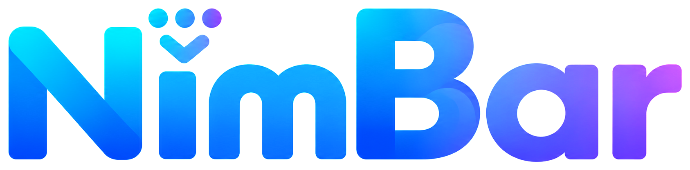

  

<h1 align="center">NimBar</h1>

<strong>A cleaner menu bar. A lighter Mac.</strong>

A free and open-source menu bar manager for macOS.

  <a href="https://github.com/emanuele0409/NimBar/releases">Releases</a>
  · <a href="https://github.com/emanuele0409/NimBar/issues">Report an issue</a>
  · <a href="https://github.com/emanuele0409">Developer</a>

  
  
  
  

> **Public release coming soon.** NimBar is not yet available for public download. The Releases page is the stable place to check when a release is announced.

## Contents

- [About NimBar](#about-nimbar)
- [Features](#features)
- [Screenshots](#screenshots)
- [Download](#download)
- [Compatibility](#compatibility)
- [Installation](#installation)
- [Opening NimBar for the First Time](#opening-nimbar-for-the-first-time)
- [Permissions](#permissions)
- [Privacy & Security](#privacy--security)
- [Updates](#updates)
- [Roadmap](#roadmap)
- [Source Code](#source-code)
- [Contributing](#contributing)
- [Reporting Issues](#reporting-issues)
- [License](#license)

## About NimBar

NimBar helps you organise the macOS menu bar by moving supported app icons between **Visible**, **Hidden**, and **Always Hidden**. You can manage the layout in NimBar or use its live divider in the menu bar.

The app is developed by [emanuele0409](https://github.com/emanuele0409) and is intended to remain free and open source.

## Features

| Feature | What it does |
| --- | --- |
| Three layout zones | Organise supported menu bar items as Visible, Hidden, or Always Hidden. |
| Drag and drop | Move supported items in the Layout view; changes are applied immediately. |
| Live divider | Hold the configured modifier shortcut (⌘ + ⌥ by default) to show a divider and change an item's visibility by dragging it across. |
| Reveal hidden items | Show or collapse the Hidden section from NimBar. Clicking an empty area of the menu bar can also reveal hidden items. |
| Automatic hiding | Optionally collapse the revealed Hidden section after a chosen delay. |
| Appearance and language | Choose light, dark, or system appearance, and use English or Italian. |
| Menu bar controls | Choose NimBar's menu bar symbol and configure the modifier shortcut. |
| Multiple displays | Layout stays tied to the main display while the live divider follows the display under the pointer. |

macOS may expose several menu bar items for one app but only allow visibility to be changed per app bundle. In that case, the related items move together. Some system items and items that macOS does not expose cannot be managed by NimBar.

Launch at login is available in General settings through macOS Login Items. The switch reflects the system registration and reports any approval still needed. NimBar can check the public GitHub Releases page and open a newer release for manual download. Automatic download and installation are not enabled until package signatures can be validated securely.

## Screenshots

Clean, real screenshots are not included yet. The repository does not currently contain presentation-ready captures, and no personal desktop screenshots are used as substitutes. Screenshots will be added here after they have been reviewed and sanitised.

Planned views:

- General settings
- Layout
- Managing hidden menu bar items
- NimBar in the macOS menu bar

## Download

**Public release coming soon.** No DMG or ZIP is published yet.

When a public build is ready, use the [NimBar Releases page](https://github.com/emanuele0409/NimBar/releases). This link will remain stable across versions. Release assets and version details will appear there only after publication.

## Compatibility

| Requirement | Current support |
| --- | --- |
| Minimum macOS version | macOS 27 |
| Processor architecture | Apple Silicon (arm64) |
| Mac menu bar | Mac models with or without a notch |
| Intel Macs | Not supported |
| macOS 26, macOS 15, and earlier | Not supported |

Compatibility claims describe the current target and supported release configuration. They do not imply support for older operating systems or Intel Macs.

## Installation

Download the current beta from [GitHub Releases](https://github.com/emanuele0409/NimBar/releases/tag/v0.2.1-beta.46). Choose the DMG for guided installation or the ZIP for manual installation. See [Installation](docs/INSTALLATION.md) for the steps.

## Opening NimBar for the First Time

This beta is not notarized by Apple and does not use a Developer ID distribution signature. macOS may therefore block its first launch or say that the developer cannot be verified. Read [Security](SECURITY.md) before opening the download.

Use macOS's **Open Anyway** option only if you trust the source and have verified that you downloaded the intended release. Do not override an alert that says NimBar is malicious, damaged, or has been tampered with. Apple may change the exact wording and location of these controls; see its [macOS 27 instructions](https://support.apple.com/en-gb/guide/mac-help/mh40617/27/mac/27) and [security guidance](https://support.apple.com/it-it/102445).

## Permissions

NimBar asks macOS for:

- **Accessibility** to inspect the menu bar items exposed by macOS and to manage their visibility.
- **Screen Recording** to capture the menu bar strip so Layout can display the original item images.
- **Input Monitoring**, only when macOS requires it for NimBar's live-drag event filter, to protect the ⌘⌥ gesture from native menu bar reordering.

Grant permissions in System Settings when prompted. You can review or revoke them in **Privacy & Security**. More detail is in [Privacy](PRIVACY.md).

## Privacy & Security

NimBar reads menu bar labels and item metadata locally and captures menu bar pixels for the Layout view. The current code keeps an icon image cache in local app preferences; it does not upload those images. NimBar has no telemetry or remote-control endpoint. Its optional update checker makes read-only requests to the public GitHub Releases API; it sends no account token or menu bar data and does not download or install packages.

The menu bar discovery and visibility implementation uses undocumented macOS interfaces in addition to public frameworks. Apple does not guarantee these interfaces, and a macOS update may change their behaviour. NimBar is not sandboxed. Review [Privacy](PRIVACY.md) and [Security](SECURITY.md) before using it.

## Updates

- Manual update checks use the public GitHub Releases API. When a newer release is found, NimBar opens its release page so you can review the notes and download it manually.
- Automatic update checks can be enabled in Settings. Automatic download and installation remain planned until packages can be verified with a trusted signature.

The current public beta is [0.2.1 beta, build 46](https://github.com/emanuele0409/NimBar/releases/tag/v0.2.1-beta.46). See [Update Design](docs/UPDATES.md) for the release tag format and signing requirements.

## Roadmap

These are planned goals, not release commitments:

- [ ] Compatibility with macOS 26
- [ ] Compatibility with macOS 15
- [ ] Intel support and a Universal Binary (arm64 + x86_64)
- [ ] Secure automatic download and installation through GitHub Releases
- [ ] Continued stability and performance work

## Source Code

The project is a native Swift and SwiftUI macOS app built with Xcode. The source and Xcode project are available in this repository. Developer setup notes are in [Contributing](CONTRIBUTING.md).

## Contributing

Contributions are welcome after the repository is public. Please read [Contributing](CONTRIBUTING.md) and the project licence before opening a pull request.

## Reporting Issues

Use [GitHub Issues](https://github.com/emanuele0409/NimBar/issues) to report reproducible problems or suggest an improvement. Do not include passwords, signing keys, private certificates, or personal data in an issue. See [Security](SECURITY.md) for security reports.

## License

NimBar is licensed under the GNU GPL version 3; see [LICENSE](LICENSE) for the terms. Third-party components retain their own notices and licences in `Scripts/vendor/`.
